# Entity-Relationship Diagram (ERD) & Arsitektur Database AkademikOS

**Dokumen:** Arsitektur Basis Data AkademikOS (Siklus.ai)  
**Track:** Education — Hackathon JOINTS UGM 2026  
**Versi:** 4.0.5  
**Engine:** SQLite 3 (WAL Mode & Busy Timeout 5000ms) / Production-Ready PostgreSQL Schema  
**Status:** Implementasi Aktif & Terverifikasi  

---

## 1. Konteks & Latar Belakang

Pada tahap awal MVP UI cepat, database lokal hanya memuat 4 tabel operasional (`users`, `profile`, `tasks`, `schedule`). Namun, untuk mewujudkan seluruh spesifikasi pada PRD JOINTS UGM 2026 (termasuk *Smart Attendance Burn-Down 75%*, *Material Depot*, *Catatan Kuliah Obsidian-style*, dan *Active Recall AI Quiz Prep*), arsitektur basis data AkademikOS kini telah diperluas menjadi **11 tabel relasional terpadu**.

Seluruh 11 tabel ini telah dideklarasikan dan di-seed dengan dataset realistis perkuliahan Teknik Informatika UGM.

---

## 2. Diagram Relasi Entitas (Mermaid ERD)

```mermaid
erDiagram
    USERS ||--|| PROFILE : "memiliki profil"
    USERS ||--o{ TASKS : "membuat & mengerjakan"
    USERS ||--o{ SCHEDULE : "memiliki jadwal"
    USERS ||--o{ COURSE_ENROLLMENTS : "mengambil KRS"
    USERS ||--o{ NOTES : "menulis catatan"
    USERS ||--o{ ATTENDANCE_LOGS : "mencatat presensi"
    USERS ||--o{ AI_QUIZZES : "mengerjakan kuis"

    LECTURERS ||--o{ COURSES : "mengampu mata kuliah"
    COURSES ||--o{ SCHEDULE : "terjadwal dalam"
    COURSES ||--o{ TASKS : "memiliki tugas"
    COURSES ||--o{ COURSE_ENROLLMENTS : "diambil oleh"
    COURSES ||--o{ MATERIALS : "memiliki repositori materi"
    COURSES ||--o{ NOTES : "dikaitkan catatan"
    COURSES ||--o{ ATTENDANCE_LOGS : "memiliki log pertemuan"
    COURSES ||--o{ AI_QUIZZES : "menghasilkan kuis"

    MATERIALS ||--o{ AI_QUIZZES : "sumber RAG kuis"

    USERS {
        string id PK "student-1, student-2"
        string name "Faras Pratama"
        string nim "23/512948/TK/54321"
        string email "faras.pratama@mail.ugm.ac.id"
        string avatar "FR"
        datetime created_at
    }

    PROFILE {
        string user_id PK, FK "Relasi ke USERS(id)"
        string name
        string nim
        string email
        string major "Teknik Informatika"
        string faculty "Fakultas Teknik"
        string university "Universitas Gadjah Mada"
        integer semester "5"
        string academic_advisor "Dr. Ir. Budi Santoso, M.Kom."
        string target_gpa "3.85"
        integer max_sks "24"
    }

    LECTURERS {
        string id PK "lec-1, lec-2"
        string nip UK "197805122003121001"
        string name "Dr. Ir. Budi Santoso, M.Kom."
        string title "Lektor Kepala / Dosen AI"
        string email "budi.santoso@ugm.ac.id"
        string phone_wa "6281234567890"
        string room "Ruang Dosen DTETI Lt. 3"
        string photo_url "URL Foto Unsplash/Kampus"
        string department "Departemen Teknik Elektro & TI"
    }

    COURSES {
        string id PK "cs-1, cs-2"
        string code UK "IF-3104"
        string name "Kecerdasan Buatan & Sistem Pakar"
        integer sks "3"
        integer semester "5"
        string primary_lecturer_id FK "Relasi ke LECTURERS(id)"
        string room_default "Lab AI - Gd. C 302"
        string lms_url "https://elok.ugm.ac.id/course/ai-2026"
        string color_theme "blue | emerald | amber | indigo"
    }

    COURSE_ENROLLMENTS {
        string id PK "en-1"
        string user_id FK "Relasi ke USERS(id)"
        string course_id FK "Relasi ke COURSES(id)"
        string academic_year "2026/2027 Ganjil"
        string target_grade "A"
        integer total_meetings "16"
        integer attended_count "7"
        integer excused_count "0"
        integer alpha_count "0"
        integer remaining_alpha "4 (Ambang 75%)"
        string status_burn_down "aman | waspada | kritis"
    }

    SCHEDULE {
        string id PK "sch-1"
        string user_id FK "Relasi ke USERS(id)"
        string course_id FK "Relasi ke COURSES(id)"
        string course "Sistem Operasi"
        string code "IF-3101"
        string room "Lab Komputasi Dasar 2"
        integer start_hour "7"
        integer duration_hours "3"
        string start_time "07.30"
        string end_time "10.00"
        string lecturer "Dr. Ahmad Fauzi, M.T."
        string day "senin s.d. sabtu"
        string status "upcoming | active | completed"
        string attendance_status "hadir | izin | sakit | pending"
        string class_type "reguler | pengganti | praktikum"
    }

    TASKS {
        string id PK "task-1"
        string user_id FK "Relasi ke USERS(id)"
        string course_id FK "Relasi ke COURSES(id)"
        string title "Implementasi BFS & Greedy Python"
        string course "Kecerdasan Buatan & Sistem Pakar"
        string difficulty "mudah | sedang | sulit"
        string task_type "praktik | dokumen | presentasi | tugas"
        string deadline_label "H-0 (Hari Ini) | H-1 | H-3"
        string deadline_date "2026-10-02 23:59"
        string weight "Tugas Praktikum (15%)"
        integer completed "0 atau 1"
        string priority "low | medium | high"
        string notes "Instruksi pengerjaan & submisi"
        datetime created_at
    }

    ATTENDANCE_LOGS {
        string id PK "att-1"
        string user_id FK "Relasi ke USERS(id)"
        string course_id FK "Relasi ke COURSES(id)"
        integer meeting_no "1 s.d. 16"
        string date "2026-09-10"
        string status "hadir | izin | sakit | alfa"
        string verification_method "qr_scan | manual"
        string notes "Keterangan presensi"
    }

    MATERIALS {
        string id PK "mat-1"
        string course_id FK "Relasi ke COURSES(id)"
        string folder_category "RPS & Silabus | Pertemuan Teori"
        string title "Slide Pertemuan 02: Heuristic Search"
        string file_name "IF3104_P02_Search.pdf"
        string file_path "/docs/materi/..."
        string file_size "4.2 MB"
        string file_type "pdf"
        integer meeting_no "2"
        integer ai_indexed "1 (Siap RAG Gemini)"
        datetime created_at
    }

    NOTES {
        string id PK "note-1"
        string user_id FK "Relasi ke USERS(id)"
        string course_id FK "Relasi ke COURSES(id)"
        string folder "Kecerdasan Buatan"
        string title "Catatan_Kuliah_Sesi_01.md"
        string content "Konten Markdown Obsidian"
        string tags "#ai #agent #search"
        integer is_starred "0 atau 1"
        datetime updated_at
    }

    AI_QUIZZES {
        string id PK "qz-1"
        string user_id FK "Relasi ke USERS(id)"
        string course_id FK "Relasi ke COURSES(id)"
        string material_id FK "Relasi ke MATERIALS(id)"
        string title "Active Recall H-3: Algoritma A*"
        integer score "90"
        integer total_questions "5"
        string questions_json "JSON Soal & Pembahasan"
        string status "pending | completed"
        datetime created_at
    }
```

---

## 3. Kamus Data & Spesifikasi Entitas

### 3.1. Entitas Pengguna & Identitas Akademik
| Tabel | Kolom Utama | Fungsi & Relasi |
| :--- | :--- | :--- |
| **`users`** | `id` (PK), `nim` (UK), `name`, `email` | Menyimpan kredensial identitas pengguna. Multi-tenant ready (bisa menampung banyak akun mahasiswa). |
| **`profile`** | `user_id` (PK, FK), `major`, `faculty`, `semester`, `academic_advisor`, `target_gpa`, `max_sks` | Detail profil akademik lengkap mahasiswa (1-to-1 dengan `users`). |

### 3.2. Entitas Kurikulum & Perkuliahan
| Tabel | Kolom Utama | Fungsi & Relasi |
| :--- | :--- | :--- |
| **`lecturers`** | `id` (PK), `nip` (UK), `name`, `title`, `phone_wa`, `room`, `photo_url` | Direktori dosen pengampu dan dosen pembimbing. Mendukung tautan langsung WhatsApp untuk koordinasi kelas pengganti. |
| **`courses`** | `id` (PK), `code` (UK), `name`, `sks`, `semester`, `primary_lecturer_id` (FK), `lms_url`, `color_theme` | Katalog mata kuliah resmi yang diambil pada semester aktif. Tautan `lms_url` menghubungkan langsung ke portal kampus (e.g. ELOK UGM). |
| **`course_enrollments`** | `id` (PK), `user_id` (FK), `course_id` (FK), `attended_count`, `remaining_alpha`, `status_burn_down` | Jembatan KRS mahasiswa dengan logika **Smart Attendance Burn-Down (Ambang 75% / Maks 4x Alfa)**. Menyimpan sisa jatah toleransi ketidakhadiran secara real-time. |

### 3.3. Entitas Penjadwalan & Tugas
| Tabel | Kolom Utama | Fungsi & Relasi |
| :--- | :--- | :--- |
| **`schedule`** | `id` (PK), `user_id` (FK), `course_id` (FK), `day`, `start_hour`, `start_time`, `end_time`, `room`, `status`, `class_type` | Jadwal mingguan 24 jam untuk 6 hari kuliah (Senin s.d. Sabtu). Mendukung penandaan kelas reguler, praktikum, maupun kelas pengganti dinamis. |
| **`tasks`** | `id` (PK), `user_id` (FK), `course_id` (FK), `title`, `difficulty` (*mudah/sedang/sulit*), `task_type` (*praktik/dokumen/presentasi/tugas*), `deadline_date`, `completed` | Manajemen tugas akademik dengan filter urgensi, bobot nilai, dan animasi penyelesaian tugas ke bawah (smooth transition). |

### 3.4. Entitas Pembelajaran, Catatan & AI
| Tabel | Kolom Utama | Fungsi & Relasi |
| :--- | :--- | :--- |
| **`materials`** | `id` (PK), `course_id` (FK), `folder_category`, `title`, `file_name`, `meeting_no`, `ai_indexed` | Repositori dokumen (Material Depot) berstruktur folder tree untuk RPS dan materi PDF pertemuan 1 s.d. 16. |
| **`notes`** | `id` (PK), `user_id` (FK), `course_id` (FK), `folder`, `title`, `content`, `tags` | Catatan perkuliahan ala Obsidian berbasis Markdown dengan fitur split layout dan mode fullscreen. |
| **`attendance_logs`** | `id` (PK), `user_id` (FK), `course_id` (FK), `meeting_no`, `date`, `status` (*hadir/izin/sakit/alfa*) | Log rinci presensi per pertemuan untuk verifikasi manual atau scan QR presensi. |
| **`ai_quizzes`** | `id` (PK), `user_id` (FK), `course_id` (FK), `material_id` (FK), `score`, `questions_json` | Rekam jejak simulasi kuis kilat H-3 berbasis RAG materi kuliah via Google Gemini. |

---

## 4. Keunggulan Arsitektur & Strategi Deployment

1. **Offline-First & Local-First (SQLite WAL):**
   - Kampus seringkali memiliki kendala koneksi Wi-Fi yang tidak stabil di ruang kuliah atau lab bawah tanah.
   - Dengan SQLite lokal bermode Write-Ahead Logging (`WAL`) dan timeout 5000ms, sistem memiliki latensi baca/tulis < 1ms, 100% tahan crash, dan tidak membutuhkan koneksi internet untuk melihat jadwal dan mencatat tugas.

2. **Multi-User Isolation:**
   - Seluruh tabel transaksional (`tasks`, `schedule`, `notes`, `attendance_logs`, `course_enrollments`) memiliki kunci asing `user_id`.
   - Hal ini menjamin isolasi data sempurna saat pengguna berganti akun antara `student-1`, `student-2`, maupun `student-3`.

3. **Kemudahan Migrasi ke Cloud (PostgreSQL / Supabase):**
   - Skema DDL dirancang dengan standar SQL ANSI yang 100% kompatibel dengan PostgreSQL/Supabase untuk rilis production daring.
